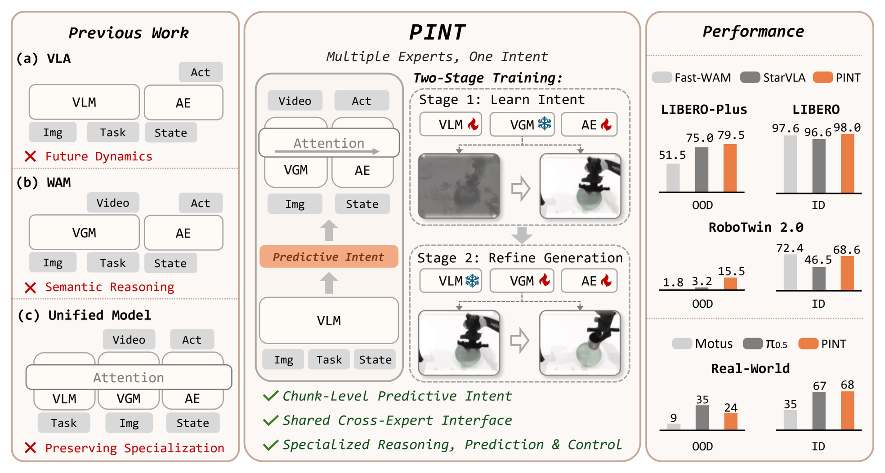

# PINT: A Unified Model with Shared Predictive Intent for Robot Manipulation

Official repository for **PINT**.

> Code will be released soon.

## Overview

**Multiple experts, one intent.** 
PINT introduces a shared chunk-level **Predictive Intent** to coordinate semantic reasoning, world prediction, and action generation while preserving specialized expert pathways.

We evaluate PINT on RoboTwin 2.0, LIBERO, LIBERO-Plus, and real-world bimanual manipulation.

  

